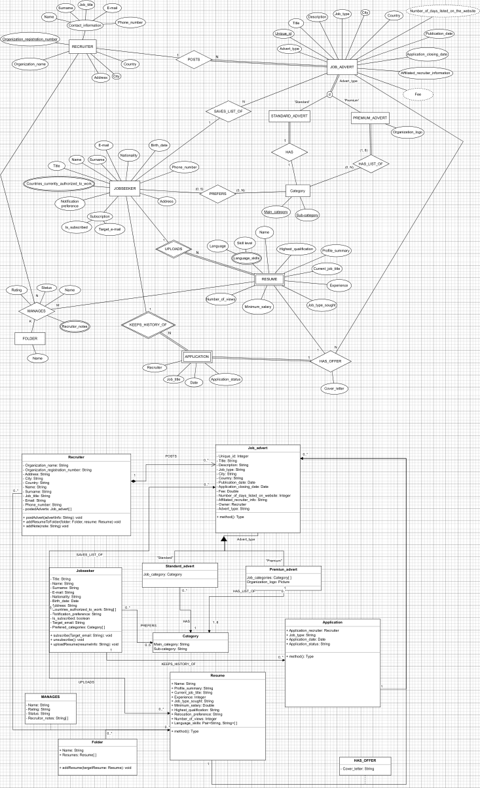

# Assignment 01 ? Recruitment database design

**Goal.** Model a recruitment portal in both enhanced ER notation and a UML class diagram. The domain includes recruiters, jobseekers, adverts, categories, r?sum?s, applications, and folders.

**Solution.** The upper half of the diagram shows the entities, relationships, and participation constraints. The lower half expresses the same design as classes and associations. Look for how the design distinguishes standard and premium adverts, connects jobseekers to their application history, and represents recruiter folders containing r?sum?s.

- [Submitted diagram as a PDF](recruitment-model.pdf). Use this for zooming in on cardinalities and attributes.
- [Editable diagrams.net source](recruitment-model.drawio). Open this to inspect or modify the model.

**Try it.** Pick the relationship between a recruiter, a folder, and a r?sum?. Sketch the tables and keys you would use to represent it. Compare how the ER and UML diagrams communicate the same information.
